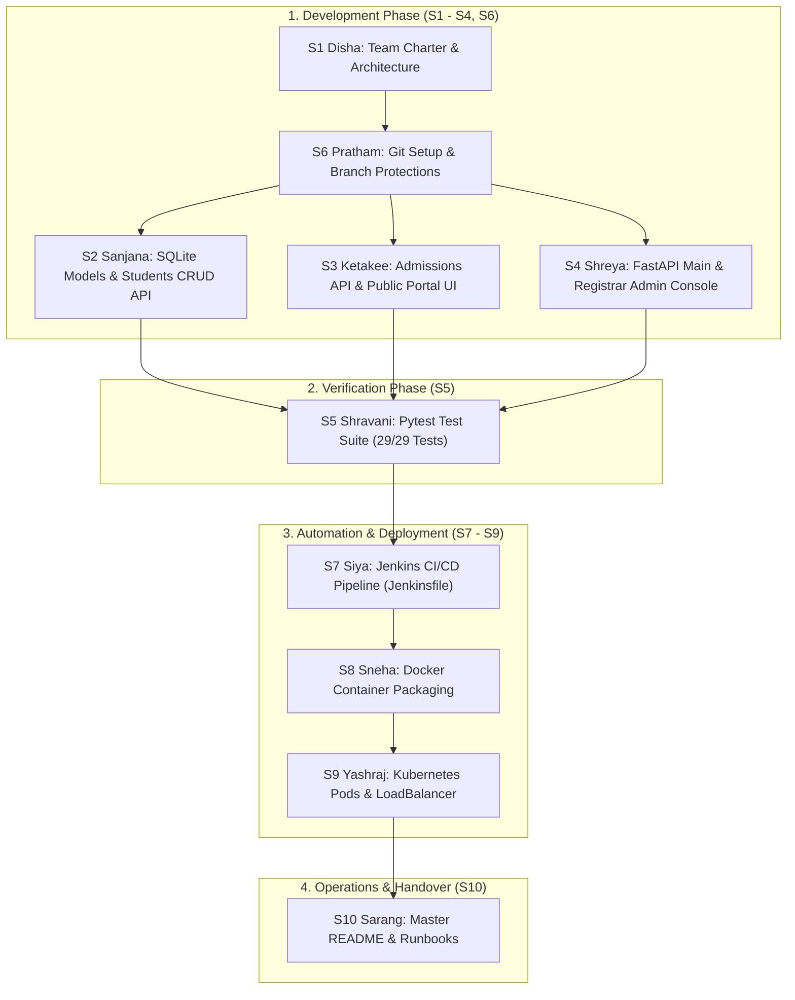

<<<<<<< HEAD
# devops-student-management
DevOps-Based Student Management Web Application

## Spring Boot API

Run the tests with `mvn test`, then start the API with `mvn spring-boot:run`.
The demo login endpoint is `POST /api/auth/login` and accepts JSON with either
a `username` or `email`, plus a non-blank `password`. It returns a dummy token
when both are present; this is not production authentication.
=======
# Student Management System

A production-grade RESTful API and responsive academic web portal for managing student registrations, admissions, enrollment workflows, and registrar operations. Built with **FastAPI**, **SQLite**, **SQLAlchemy 2.0**, **Docker**, **Jenkins**, and **Kubernetes**.

---

## 1. System Architecture & 10-Person DevOps Workflow

The project is structured according to a strict 10-person DevOps engineering team distribution model. Every member has dedicated deliverables with automated quality gates and CI/CD integration.



---

## 2. End-to-End Execution Plan (How The Project Is Built)

### Phase 1: Project Governance & Version Control Setup
* **Lead Engineers:** `S1_Disha` (Team Lead) & `S6_Pratham` (Git Governance)
* **Execution:**
  1. Disha authored `docs/Team_Charter.md`, `docs/Project_Architecture.md`, and `docs/Design_System.md` establishing GitFlow branching (`feature/<role-id>-<task>`), code review standards, and architectural blueprints.
  2. Pratham established `.gitignore` excluding Python cache, virtual environments, and SQLite runtime databases (`students.db`), enabling clean GitHub repository hygiene.

### Phase 2: Core Application Development
* **Lead Engineers:** `S2_Sanjana` (Backend Core), `S3_Ketakee` (Public Portal), `S4_Shreya` (System Orchestrator)
* **Execution:**
  1. **Sanjana (Database & Registry API):** Configured SQLAlchemy ORM persistence in `database.py`, models in `models.py` (`StudentModel`, `EnrollmentRequestModel`), and CRUD endpoints in `routers/students.py`.
  2. **Ketakee (Public Student Portal & Admissions):** Implemented `routers/enrollments.py` and built `static/index.html` featuring interactive search, department filtering, academic year selector, dynamic student profile modals, and course admission application forms.
  3. **Shreya (System Orchestrator & Registrar Console):** Assembled `main.py` with CORS, routing, and static file mounting; delivered `routers/admin.py` with KPI analytics and automated status cascades; and developed `static/admin.html` for reviewing admission applications and student directory control.

### Phase 3: Automated Quality Assurance
* **Lead Engineer:** `S5_Shravani` (QA & Test Automation)
* **Execution:**
  1. Managed `requirements.txt` with pinned dependencies.
  2. Authored `test_main.py` with 29 exhaustive unit, integration, cascade, and lifecycle tests using isolated database fixtures.
  3. Enforced 100% test pass rate (`pytest test_main.py`).

### Phase 4: Containerization & CI/CD Pipeline
* **Lead Engineers:** `S7_Siya` (Jenkins CI/CD) & `S8_Sneha` (Docker Packaging)
* **Execution:**
  1. **Sneha (Docker):** Built lightweight `Dockerfile` based on `python:3.10-slim` with layer caching optimization and minimal footprint `.dockerignore`.
  2. **Siya (Jenkins CI):** Configured declarative `Jenkinsfile` with 5 automated stages (Checkout, Install Dependencies, Run Pytest Suite, Build Docker Image, Deploy to Kubernetes).

### Phase 5: Cloud Orchestration & SRE Operations
* **Lead Engineers:** `S9_Yashraj` (Kubernetes) & `S10_Sarang` (DevOps Documentation)
* **Execution:**
  1. **Yashraj (Kubernetes):** Authored `k8s/deployment.yaml` (2 replicas with liveness/readiness health probes) and `k8s/service.yaml` (LoadBalancer routing port 80 to 8000).
  2. **Sarang (SRE & Docs):** Maintains master `README.md` and operational runbooks for local deployment, containerization, and incident recovery.

---

## 3. Team Member Distribution & Deliverables

Every member has their dedicated directory in the project:

| Member Folder | Member Name | Role ID & Title | Primary Deliverables |
|---|---|---|---|
| `S1_Disha` | Disha | S1 - Project Lead & Architect | `docs/Team_Charter.md`, `docs/Project_Architecture.md`, `docs/Design_System.md` |
| `S2_Sanjana` | Sanjana | S2 - Backend Core Engineer | `database.py`, `models.py`, `routers/students.py` |
| `S3_Ketakee` | Ketakee | S3 - Public Portal & Admissions | `routers/enrollments.py`, `static/index.html` |
| `S4_Shreya` | Shreya | S4 - System Orchestrator | `main.py`, `routers/admin.py`, `static/admin.html` |
| `S5_Shravani` | Shravani | S5 - QA Engineer | `requirements.txt`, `test_main.py` (29/29 tests) |
| `S6_Pratham` | Pratham | S6 - Git Governance Engineer | `.gitignore`, Branch Protection Standards |
| `S7_Siya` | Siya | S7 - CI/CD Pipeline Engineer | `Jenkinsfile` (5 declarative stages) |
| `S8_Sneha` | Sneha | S8 - Containerization Engineer | `Dockerfile`, `.dockerignore` |
| `S9_Yashraj` | Yashraj | S9 - Kubernetes Engineer | `k8s/deployment.yaml`, `k8s/service.yaml` |
| `S10_Sarang` | Sarang | S10 - DevOps & SRE Coordinator | `README.md`, Operational Runbooks |

---

## 4. API Endpoints Catalog

### Health Probes
- `GET /` — API health check and service identification.
- `GET /health` — Kubernetes liveness and readiness probe endpoint.

### Student Management (`/students`)
- `POST /students` — Register a new student record (Validates unique `student_id`).
- `GET /students` — List all registered students (Supports `?department=`, `?status=`, and `?search=`).
- `GET /students/{student_id}` — Retrieve detailed profile for an individual student.
- `PUT /students/{student_id}` — Update student profile details (name, department, course, year, description).
- `DELETE /students/{student_id}` — Remove a student record from the database.

### Admission & Enrollment Requests (`/enrollments`)
- `POST /enrollments` — Submit an admission or course registration application.
- `GET /enrollments` — List all submitted admission applications.
- `GET /enrollments/{request_id}` — Retrieve details of an individual application.

### Administration & Registrar Console (`/admin`)
- `GET /admin/dashboard` — Live operational KPIs (total students, active students, total requests, pending requests, department distribution).
- `PUT /admin/enrollments/{request_id}/status` — Approve or reject admission requests with automatic status cascade to `enrolled`.
- `PUT /admin/students/{student_id}/status` — Directly update student status (`active`, `enrolled`, `graduated`, `inactive`).
- `DELETE /admin/students/{student_id}` — Remove student record with cascade to enrollment requests.

---

## 5. Local Setup & Quickstart Runbook

### Prerequisites
- Python 3.10+ installed
- Pip package manager

### 1. Install Dependencies
```bash
pip install -r requirements.txt
```

### 2. Run Automated Pytest Suite
```bash
pytest test_main.py -v
```

### 3. Launch the Application Server
```bash
uvicorn main:app --reload --host 127.0.0.1 --port 8000
```

### 4. Access the Web Interfaces
- **Public Student Portal:** [http://127.0.0.1:8000/](http://127.0.0.1:8000/)
- **Registrar Admin Console:** [http://127.0.0.1:8000/static/admin.html](http://127.0.0.1:8000/static/admin.html)
- **Interactive OpenAPI Docs:** [http://127.0.0.1:8000/docs](http://127.0.0.1:8000/docs)

---

## 6. Containerization & Kubernetes Deployment

### Build & Run via Docker
```bash
# Build the Docker image
docker build -t student-api:latest .

# Run the container
docker run -d -p 8000:8000 --name student-api-container student-api:latest
```

### Deploy to Kubernetes
```bash
# Apply deployment and service manifests
kubectl apply -f k8s/deployment.yaml
kubectl apply -f k8s/service.yaml

# Verify pod status
kubectl get pods -l app=student-api
kubectl get svc student-service
```
>>>>>>> origin/develop

---

## 7. Spring Boot Login API (Feature Branch)

A demo login endpoint implemented using Spring Boot.

### Run Tests

```bash
mvn test
```

### Start the API

```bash
mvn spring-boot:run
```

### Login Endpoint

- **Method:** `POST`
- **Path:** `/api/auth/login`
- **Request:** JSON containing `username` or `email`, and `password`.
- **Response:** A demo authentication token when the required credentials are present.

**Note:** This is a demonstration endpoint, not production authentication.
