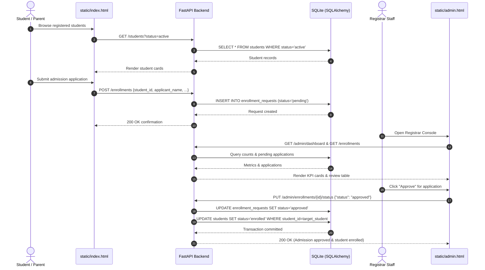

# Project Architecture — Student Management System

## 1. System Overview
The **Student Management System** utilizes a multi-tier, decoupled architecture designed for high maintainability, operational reliability, and clean separation of concerns.

```mermaid
flowchart TB
    subgraph Clients["Clients & Users"]
        PublicUser["Public User (Student / Parent)"]
        AdminUser["Registrar & Academic Admin"]
    end

    subgraph Presentation["Presentation Layer (Static Portals)"]
        PublicUI["Public Student Portal<br/>(static/index.html)"]
        AdminUI["Registrar Console<br/>(static/admin.html)"]
    end

    subgraph Ingress["Ingress & Networking"]
        K8sSvc["Kubernetes Service<br/>(LoadBalancer: Port 80)"]
    end

    subgraph Application["FastAPI Application (main.py)"]
        StaticMount["StaticFiles Mount<br/>(/static)"]
        HealthRoute["Health Routes<br/>(GET /, GET /health)"]
        
        subgraph Routers["API Routers"]
            StudentsRouter["Students Router<br/>(routers/students.py)"]
            EnrollmentsRouter["Enrollments Router<br/>(routers/enrollments.py)"]
            AdminRouter["Admin Router<br/>(routers/admin.py)"]
        end
    end

    subgraph DataLayer["Persistence Layer (SQLAlchemy 2.0)"]
        SessionMgr["Session Management<br/>(database.py: get_db)"]
        Models["Relational ORM Models<br/>(models.py: StudentModel, EnrollmentRequestModel)"]
        SQLiteDB[("SQLite Database<br/>(students.db)")]
    end

    PublicUser -->|HTTP /| K8sSvc
    AdminUser -->|HTTP /static/admin.html| K8sSvc
    K8sSvc --> StaticMount
    K8sSvc --> HealthRoute
    
    PublicUI -->|GET /students<br/>POST /enrollments| StudentsRouter
    PublicUI -.-> EnrollmentsRouter
    AdminUI -->|GET /admin/dashboard<br/>PUT /admin/enrollments/{id}<br/>DELETE /admin/students/{id}| AdminRouter
    AdminUI -->|POST /students| StudentsRouter

    StudentsRouter --> SessionMgr
    EnrollmentsRouter --> SessionMgr
    AdminRouter --> SessionMgr
    SessionMgr --> Models
    Models --> SQLiteDB
```

---

## 2. Core Architectural Components

### 2.1 Persistence Layer (`database.py` & `models.py`)
- **Database Engine**: Powered by SQLAlchemy 2.0 with a persistent SQLite storage backend (`sqlite:///./students.db`). Configured with `connect_args={"check_same_thread": False}` for multi-threaded FastAPI async handling.
- **Session Lifecycle**: The `get_db()` dependency establishes a thread-safe `SessionLocal()` generator yielding active sessions and guaranteeing cleanup via `finally: db.close()`.
- **Relational Schema**:
  - `StudentModel` (`students` table): Primary key `student_id` (String), `name`, `department`, `course`, `year`, `description`, `status` (`active`, `enrolled`, `graduated`, `inactive`). Has one-to-many relationship with `enrollment_requests`.
  - `EnrollmentRequestModel` (`enrollment_requests` table): Primary key `request_id` (String), foreign key `student_id` referencing `students.student_id` (with `ondelete="CASCADE"`), `applicant_name`, `applicant_email`, `message`, `status` (`pending`, `approved`, `rejected`).
- **Startup Table Creation**: `init_db()` is invoked during application startup in `main.py` (`Base.metadata.create_all(bind=engine)`), automatically provisioning tables if absent.

### 2.2 Presentation Layer & Frontend Separation
The frontend interface is strictly separated into two independent portals:

1. **Public Student Portal (`static/index.html`)**:
   - **Target Audience**: Students, parents, and prospective applicants.
   - **Capabilities**: View registered student catalog, filter by department, status, academic year, search keyword, inspect student details, and submit course admission applications.
   - **Isolation Guarantee**: Strictly devoid of administrative controls, KPI displays, approval/rejection triggers, or `/admin/*` API calls.

2. **Registrar Operations Console (`static/admin.html`)**:
   - **Target Audience**: Academic administrators and registrar staff.
   - **Capabilities**:
     - **Operations KPIs**: Displays live counts for total students, active students, total applications, and pending applications (`GET /admin/dashboard`).
     - **Application Review Queue**: Lists all submitted admission applications with one-click **Approve** and **Reject** buttons (`PUT /admin/enrollments/{id}/status`).
     - **Student Registry Management**: Register new students (`POST /students`), update status (`PUT /admin/students/{id}/status`), and remove records (`DELETE /admin/students/{id}`).
   - **Business Logic Cascade**: Approving an admission application automatically cascades the associated student's status to `enrolled`.

### 2.3 API Router Architecture (`routers/`)
- `routers/students.py`: Handles student registration (`POST /students`), registry listings with filtering (`GET /students`), record retrieval (`GET /students/{student_id}`), and profile updates (`PUT /students/{student_id}`).
- `routers/enrollments.py`: Handles admission application submissions (`POST /enrollments`), application listings (`GET /enrollments`), and lookup (`GET /enrollments/{request_id}`). Enforces student eligibility validation.
- `routers/admin.py`: Provides administrative KPI metrics (`GET /admin/dashboard`), admission approval/rejection with student status cascade (`PUT /admin/enrollments/{request_id}/status`), student status updates (`PUT /admin/students/{student_id}/status`), and student record deletion (`DELETE /admin/students/{student_id}`).

---

## 3. Admission & Enrollment Lifecycle Flow


---

## 4. DevOps & Deployment Architecture
- **Containerization (`Dockerfile`)**: Lightweight Python container running Uvicorn. Excludes runtime database and test caches via `.dockerignore`.
- **CI/CD Pipeline (`Jenkinsfile`)**: Declarative pipeline orchestrating checkout, dependency installation, pytest automated testing, Docker build, and Kubernetes deployment.
- **Kubernetes Orchestration (`k8s/`)**: Deployment manifest managing pod replicas and resource specifications, coupled with a LoadBalancer Service exposing port 80.
- **Team Distribution Architecture**: Clean 10-person student distribution with zero overlap and zero runtime pollution.
